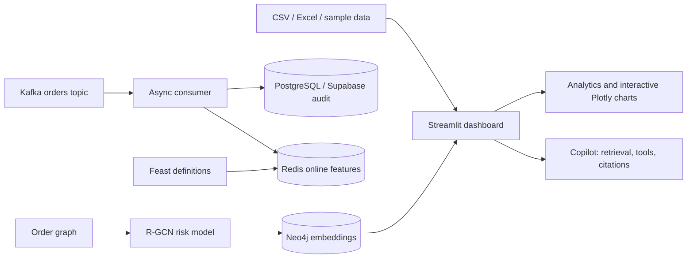

# IndiaCommerce Analytics

Interactive analytics and decision support for Indian ecommerce teams. Explore sales, customers, pricing, operations, and risk in a Streamlit dashboard with Plotly visualizations. The repository also includes optional streaming, feature store, graph risk, and copilot evaluation components.

<p align="center">
  <a href="https://indian-ecommerce-analytics-arxf6zhgntbmhby5vcvsgy.streamlit.app/"><strong>🚀 Launch the live dashboard</strong></a>
  &nbsp; · &nbsp; <a href="https://github.com/SumedhPatil1507/indian-ecommerce-analytics">⭐ Explore the code</a>
  &nbsp; · &nbsp; <a href="https://www.kaggle.com/datasets/shukla922/indian-e-commerce-pricing-revenue-growth">📦 Get sample data</a>
</p>

<p align="center">
  
  
  
  
</p>

<details open>
  <summary><strong>🧭 Jump to a section</strong></summary>
  <p>
    <a href="#run-the-dashboard">Run it</a> ·
    <a href="#explore-the-dashboard">Explore tabs</a> ·
    <a href="#how-the-pieces-fit">Architecture</a> ·
    <a href="#optional-production-data-components">Advanced data stack</a> ·
    <a href="#deploy-on-streamlit-community-cloud">Deploy</a> ·
    <a href="#repository-map">Repository</a>
  </p>
</details>

## Run the dashboard

Requires Python 3.11 (3.10+ supported). From this directory:

<details open>
<summary><strong>💻 Start locally</strong></summary>

```bash
python -m venv .venv
# Windows: .venv\Scripts\activate
# macOS/Linux: source .venv/bin/activate
python -m pip install --upgrade pip
pip install -r requirements.txt
streamlit run dashboard/app.py
```

</details>

Open the local URL printed by Streamlit. Use the Data Connector tab to upload a CSV/XLSX order file or start with the built-in sample data. Filters and selections update the dashboard across tabs.

### Make the charts work for you

Charts use Plotly. Hover for details, drag to zoom, pan, select ranges, toggle traces in the legend, and use the toolbar to reset or download a chart as PNG. Most dashboard filters update all tabs together.

## Explore the dashboard

<details>
<summary><strong>📊 Browse all 18 analytics tabs</strong></summary>

| Tab | Explore |
|---|---|
| Data Connector | Upload a file or use sample data |
| Executive Summary | KPIs, opportunities, risks, and exports |
| Price Optimizer | Category pricing with Lerner-index constraints |
| At-Risk Customers | RFM churn scoring |
| Model Drift | Feature drift and model health |
| Revenue Trends | Sales, AOV, discount, and brand trends |
| Categories | Category revenue and performance |
| Regional | State and zone comparisons |
| Inventory | Velocity alerts and stock signals |
| CLV | Customer lifetime value tiers |
| Anomalies | Isolation Forest, DBSCAN, statistics, optional graph risk |
| Cohort | Retention over time |
| Pareto | Revenue concentration and 80/20 patterns |
| Operational Actions | Review actions and export cohorts |
| Merchant Insights Copilot | Ask questions and inspect evidence |
| Exploratory Analysis | Interactive distributions and comparisons |
| Forecasting | Seasonality and forecast horizons |
| ML Models | Compare models and feature importance |

</details>

Anomaly detection combines Isolation Forest, DBSCAN, and statistical signals. When a trained graph model is available, the anomaly view also surfaces RTO and promotional fraud risk scores.

## How the pieces fit



<details>
<summary><strong>🔎 What is included in the interactive app?</strong></summary>

- Shared filters and selectable metrics for exploring your uploaded data.
- Hover details, zoom, pan, legend controls, and chart downloads on Plotly charts.
- Copilot responses with source and retrieved chunk citations; unverified recommendations enter a fallback state.
- Optional RTO and promotional-fraud scores shown alongside anomaly signals when a trained graph checkpoint is configured.

</details>

## Optional production data components

The dashboard runs without external services. Install the additional dependencies only when working with the corresponding infrastructure:

```bash
pip install -r requirements-advanced.txt
```

| Component | Implementation | Purpose |
|---|---|---|
| Feast feature store | `feature_store.yaml`, `data/features.py` | Customer and merchant entities with time-aware order velocity, AOV, and discount sensitivity features. |
| Kafka ingestion | `data/kafka_consumer.py` | Async consumption from `ecommerce.orders.v1`; manual offsets are committed after audit persistence and Redis feature-cache writes succeed. |
| Audit and online store | `supabase_schema.sql` | PostgreSQL/Supabase audit schema and Redis-backed online features. |
| R-GCN graph risk | `modules/rto_graph.py`, `scripts/train_rto_gnn.py` | Heterogeneous buyer, pincode, device, and payment graph model; training writes node embeddings to Neo4j. |
| Copilot validation and tracing | `modules/copilot.py` | Guardrails validation, grounded citations, discount controls, and OpenTelemetry spans. |
| Copilot evaluation | `eval/ragas_copilot_eval.py` | RAGAS audit over 50 merchant prompts, exporting metric results as JSON. |

<details>
<summary><strong>🔌 Configure external services</strong></summary>

Copy `.env.example` to `.env` and set credentials only for services you enable. Never commit `.env` or Streamlit secrets.


```dotenv
KAFKA_BOOTSTRAP_SERVERS=localhost:9092
DATABASE_URL=postgresql://...
REDIS_URL=redis://localhost:6379/0
SUPABASE_URL=https://your-project.supabase.co
SUPABASE_KEY=...
NEO4J_URI=bolt://localhost:7687
NEO4J_USER=neo4j
NEO4J_PASSWORD=...
OPENAI_API_KEY=...
OTEL_EXPORTER_OTLP_ENDPOINT=http://localhost:4318
```

For Streamlit Community Cloud, set supported values in the app's **Settings → Secrets**. Kafka, database, Redis, and Neo4j services must be reachable from the deployment environment. The dashboard's basic analytics do not require them.

</details>

<details>
<summary><strong>🧪 Initialize Feast, train graph risk, or evaluate the Copilot</strong></summary>

Initialize and inspect Feast definitions with the Feast CLI from the repository root:

```bash
feast -c . apply
```

Train graph risk and write embeddings to Neo4j with:

```bash
python scripts/train_rto_gnn.py --help
```

Run the copilot evaluation (requires configured model access):

```bash
python eval/ragas_copilot_eval.py
```

</details>

## Deploy on Streamlit Community Cloud

<details>
<summary><strong>☁️ Show deployment steps</strong></summary>

1. Create a new app from this GitHub repository.
2. Set **Main file path** to `dashboard/app.py`.
3. Deploy with `requirements.txt` for the standard dashboard.
4. Add supported keys under **App settings → Secrets** if you enable Copilot or connected services.

The standard requirements include the dashboard and Copilot runtime. Graph training, Kafka, Feast, and RAGAS are in `requirements-advanced.txt` to keep the dashboard install smaller. Docker remains available for the API service.

</details>

## Repository map

```text
dashboard/       Streamlit app, tabs, styling, and interactive charts
modules/         Analytics, anomaly detection, pricing, copilot, and graph model
data/            Feature definitions and Kafka consumer
api/             FastAPI service
scripts/         Graph model training CLI
eval/            RAGAS copilot evaluation
tests/           Unit tests
```

## License

See [LICENSE](LICENSE).
