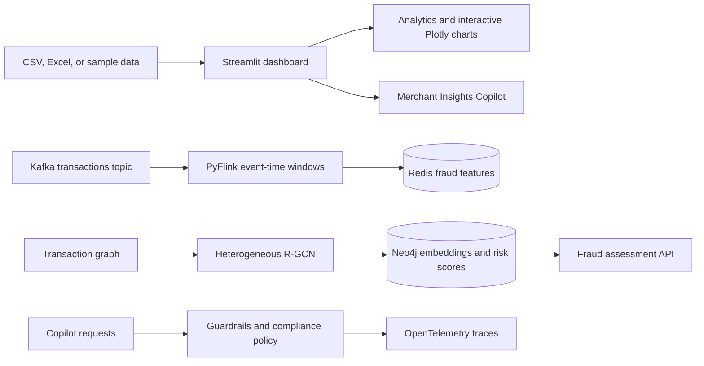

# IndiaCommerce Analytics

**Explore sales, customers, pricing, operations, and fraud risk for Indian ecommerce.** IndiaCommerce Analytics combines an interactive Streamlit dashboard with optional streaming, graph-risk, and AI copilot components.

<p align="center">
  <a href="https://indian-ecommerce-analytics-arxf6zhgntbmhby5vcvsgy.streamlit.app/"><strong>Launch the live dashboard</strong></a>
  &nbsp; | &nbsp;
  <a href="https://sumedhpatil1507.github.io/indian-ecommerce-analytics/"><strong>Open interactive chart demo</strong></a>
  &nbsp; | &nbsp;
  <a href="https://github.com/SumedhPatil1507/indian-ecommerce-analytics">Browse the source</a>
</p>

<p align="center">
  
  
  
  
</p>

> Want to try the charts before installing? The [interactive preview](https://sumedhpatil1507.github.io/indian-ecommerce-analytics/) has category filters, hover details, zoom, pan, and a time-range slider. Its displayed data is illustrative. The full dashboard accepts your own data.

## What you can explore

The dashboard has 18 analytics areas, with shared filters and interactive Plotly charts. Hover over marks for details, drag to zoom, pan, toggle series in the legend, and reset or download charts from the toolbar.

| Area | Examples |
|---|---|
| Business performance | Executive KPIs, revenue trends, categories, regions, and Pareto analysis |
| Customers | At-risk RFM cohorts, customer lifetime value, and retention cohorts |
| Pricing and inventory | Price recommendations, Lerner-index constraints, inventory velocity, and alerts |
| Model and risk | Drift monitoring, anomaly detection, optional RTO and promotion-fraud scores |
| Planning and exploration | Forecasting, exploratory analysis, model comparison, and feature importance |
| Operations and assistance | Action queue, data connectors, exports, and Merchant Insights Copilot |

The optional FraudGuard components add Kafka-to-Redis transaction features, a heterogeneous customer/merchant/device/IP graph model, and a fraud-assessment API response with a consistent explainable JSON shape. They require separate infrastructure and configuration; the dashboard's standard analytics work without Kafka, Redis, Neo4j, or model credentials.

## Run locally

Use Python 3.11 (Python 3.10+ is supported). In PowerShell, from the repository directory:

```powershell
py -3.11 -m venv .venv
.\.venv\Scripts\Activate.ps1
python -m pip install --upgrade pip
python -m pip install -r requirements.txt
streamlit run dashboard/app.py
```

Open the local URL printed in the terminal. Start with built-in sample data, or use the Data Connector to upload CSV, TSV, Excel, JSON, or Parquet files. The order dataset should include `order_date`, `base_price`, `final_price`, `units_sold`, `revenue`, and `discount_percent`, plus useful dimensions such as `category`, `state`, and `zone`.

## Interactive plots

The repository's dashboard charts are rendered with Plotly. GitHub README pages do not execute embedded JavaScript, so this repository publishes a dedicated [interactive chart playground](https://sumedhpatil1507.github.io/indian-ecommerce-analytics/) through GitHub Pages. The sample preview includes:

- Monthly revenue and order volume with a time-range slider.
- Regional revenue with hover values.
- Discount-versus-order-value scatter points, filterable by category.
- Responsive layout, pan, zoom, reset, and chart toolbar controls.

The preview uses deterministic illustrative data and loads Plotly from its CDN. For live data and all dashboard tabs, [launch Streamlit](https://indian-ecommerce-analytics-arxf6zhgntbmhby5vcvsgy.streamlit.app/) or run the app locally.

## Architecture



## Optional streaming and AI components

Install the additional dependencies only when you need these components:

```powershell
python -m pip install -r requirements-advanced.txt
```

| Component | Code | Purpose |
|---|---|---|
| Flink fraud stream | `src/streaming/flink_fraud_processor.py` | Consume `financial.transactions.v1`; calculate event-time sliding 10-second customer transaction features and write them to Redis. |
| Heterogeneous fraud GNN | `src/models/gnn_fraud.py`, `scripts/train_gnn_fraud.py` | Train collusion and RTO heads over customer, merchant, device, and IP node types; write embeddings and customer risk scores to Neo4j. |
| Graph RTO model | `modules/rto_graph.py`, `scripts/train_rto_gnn.py` | Buyer/pincode/device/payment graph scoring. |
| Kafka order consumer | `data/kafka_consumer.py` | Consume `ecommerce.orders.v1`, persist audit records, and update Redis features. |
| Fraud assessment API | `GET /fraud/assessment?customer_id=...` | Return the exact four-field fraud contract (`verdict`, `reasoning`, `recommendation`, `next_steps`), including a safe unavailable assessment when data is missing. Reasoning includes available R-GCN scores, graph centrality, and XGBoost SHAP contributions. |
| Copilot controls | `src/agent_graph.py`, `modules/copilot.py` | Guardrails validation, configurable FinCEN/RBI policy checks, pricing controls, and OpenTelemetry spans. |
| Copilot evaluation | `eval/ragas_copilot_eval.py` | Evaluate merchant question answering and export metrics as JSON. |

### Configure external services

Copy `.env.example` to `.env` and set credentials only for services you use. Do not commit `.env` or Streamlit secrets.

```dotenv
KAFKA_BOOTSTRAP_SERVERS=localhost:9092
DATABASE_URL=postgresql://...
REDIS_URL=redis://localhost:6379/0
FLINK_KAFKA_CONNECTOR_JAR=/path/to/flink-sql-connector-kafka.jar
NEO4J_URI=bolt://localhost:7687
NEO4J_USER=neo4j
NEO4J_PASSWORD=...
OPENAI_API_KEY=...
OTEL_EXPORTER_OTLP_ENDPOINT=http://localhost:4318
# COPILOT_COMPLIANCE_POLICY_JSON=<compliance-approved JSON policy>
```

#### Run the Flink fraud job

Install `requirements-flink.txt` in a PyFlink runtime compatible with your Flink cluster. Add the matching Flink Kafka connector JAR and configure Kafka and Redis, then run:

```powershell
python src/streaming/flink_fraud_processor.py
```

Events need a customer identifier, numeric amount, device identifier, and timezone-aware event timestamp (or supported epoch timestamp). The job writes per-customer transaction count, rolling amount, adjacent device changes, and window timestamps as Redis feature snapshots.

#### Train the heterogeneous fraud GNN

Install `requirements-advanced.txt`. The input CSV needs `customer_id`, `merchant_id`, `device_id`, and `ip_address`, plus at least one binary `collusion_label` or `rto_label` customer label. Configure Neo4j and run:

```powershell
python scripts/train_gnn_fraud.py --input transactions.csv
```

The checkpoint is written to `artifacts/fraud_rgcn.pt`. Neo4j nodes receive `gnn_embedding` and `gnn_model`; customer nodes also receive `collusion_probability` and `rto_probability`.

#### Configure Copilot compliance rules

Set `COPILOT_COMPLIANCE_POLICY_JSON` to compliance-approved FinCEN and/or RBI jurisdiction rules. Each rule identifies its applicability, trigger, source URL, effective date, and—when relevant—a numeric limit and currency. Regulatory answers fail closed if the jurisdiction or applicable configured rule is missing. The regulated entity's compliance team owns threshold review and updates.

## Deploy

### Streamlit Community Cloud

1. Create an app from this GitHub repository.
2. Set the main file to `dashboard/app.py`.
3. Use `requirements.txt` for the standard dashboard runtime.
4. Configure optional credentials in the app's Secrets settings.

The interactive chart demo is published from `docs/` by `.github/workflows/pages.yml` when changes reach `main`. If GitHub Pages has not previously been enabled for the repository, select **Settings → Pages → GitHub Actions** once; subsequent deployments run automatically.

## Repository map

```text
dashboard/       Streamlit dashboard, styling, and Copilot tab
modules/         Analytics, pricing, anomaly, graph, and forecasting logic
data/            Data loading, connectors, and Kafka consumer
src/             Fraud stream processor, GNN model, and agent graph
api/             FastAPI service
scripts/         Model training CLIs
docs/            GitHub Pages interactive chart demo
eval/            Copilot evaluation
tests/           Unit tests
```

## License

MIT. See [LICENSE](LICENSE).
